# Entity-relationship diagram (Phase 0 / P1 core schema)

Generated from the local database after `pnpm db:reset` (migrations up to T4). Tables from later
phases (deals, zones, reservations, expenses, shifts) are added in their phases.

Notes:
- Every business table also has `branch_id → branches.id` (multi-branch prepared, spec 9.1).
  Those links are not drawn, to keep the diagram readable.
- Money columns are `bigint` minor units (paisa). Rates are basis points.
- `order_items.line_total` is generated (`price_snapshot × quantity`).
- Internal helpers live in the `private` schema: `business_date`, `next_order_number`,
  `round_to_unit`, `compute_order_totals`, `calc_order_totals`, `has_active_role`.
- Key constraints: one open order per table (BR-05), unique `orders.request_id` (BR-15),
  unique `(payments.request_id, tender_no)`, quantity 1–99, payment `amount > 0`.
- Append-only: `order_status_history`, `audit_log`; `payments` are never deleted and change
  only by a one-time Admin void.

```mermaid
erDiagram
    branches ||--o{ settings : "configures"
    AUTH_USERS ||--o{ profiles : "login"
    categories ||--o{ menu_items : "category_id"
    restaurant_tables |o--o{ orders : "table_id (Dine-In)"
    profiles |o--o{ orders : "waiter_id, created_by, cancelled_by"
    orders ||--o{ order_batches : "order_id"
    order_batches ||--o{ order_items : "order_id + batch_no"
    menu_items ||--o{ order_items : "menu_item_id (snapshot)"
    profiles |o--o{ order_items : "cancelled_by"
    orders ||--o{ order_status_history : "order_id"
    profiles |o--o{ order_status_history : "changed_by"
    orders ||--o{ payments : "order_id"
    profiles ||--o{ payments : "received_by, voided_by"
    profiles |o--o{ audit_log : "user_id"
    AUTH_USERS {
        uuid id PK "Supabase Auth (auth.users)"
    }
    branches {
        uuid id PK
        text name
        boolean is_active
        timestamptz created_at
        timestamptz updated_at
    }
    settings {
        uuid branch_id PK
        text restaurant_name
        text address
        text phone
        text receipt_footer
        text currency_code
        smallint currency_minor_units
        text timezone
        time day_cutoff_time
        integer tax_bps
        integer service_charge_bps
        boolean prices_include_tax
        boolean discount_reduces_charges
        boolean service_charge_on_dine_in
        boolean service_charge_on_take_away
        boolean service_charge_on_delivery
        boolean tax_on_service_charge
        rounding_mode rounding_mode
        integer rounding_unit_minor
        smallint kitchen_warn_min
        smallint kitchen_late_min
        timestamptz created_at
        timestamptz updated_at
    }
    profiles {
        uuid id PK
        uuid branch_id FK
        text username
        text full_name
        text phone
        app_role role
        boolean is_active
        timestamptz created_at
        timestamptz updated_at
    }
    categories {
        uuid id PK
        uuid branch_id FK
        text name
        text image_path
        integer sort_order
        boolean is_active
        timestamptz created_at
        timestamptz updated_at
    }
    menu_items {
        uuid id PK
        uuid branch_id FK
        uuid category_id FK
        text name
        text description
        bigint price
        bigint cost_price
        text image_path
        smallint prep_time_min
        boolean needs_kitchen
        boolean is_available
        integer sort_order
        boolean is_active
        timestamptz created_at
        timestamptz updated_at
    }
    restaurant_tables {
        uuid id PK
        uuid branch_id FK
        integer number
        smallint capacity
        text section
        table_status status
        boolean is_active
        timestamptz created_at
        timestamptz updated_at
    }
    orders {
        uuid id PK
        uuid branch_id FK
        text order_number
        date business_date
        order_type type
        order_source source
        order_status status
        uuid table_id FK
        uuid waiter_id FK
        uuid created_by FK
        text customer_name
        text customer_phone
        bigint subtotal
        bigint discount
        text discount_reason
        bigint service_charge
        bigint tax
        bigint total
        payment_status payment_status
        boolean bill_requested
        timestamptz bill_requested_at
        uuid request_id
        text cancel_reason
        uuid cancelled_by FK
        timestamptz accepted_at
        timestamptz preparing_at
        timestamptz ready_at
        timestamptz served_at
        timestamptz completed_at
        timestamptz cancelled_at
        timestamptz created_at
        timestamptz updated_at
    }
    order_batches {
        uuid id PK
        uuid branch_id FK
        uuid order_id FK
        smallint batch_no
        batch_status status
        timestamptz sent_at
        timestamptz preparing_at
        timestamptz ready_at
        timestamptz served_at
        timestamptz cancelled_at
        timestamptz created_at
        timestamptz updated_at
    }
    order_items {
        uuid id PK
        uuid branch_id FK
        uuid order_id FK
        smallint batch_no FK
        uuid menu_item_id FK
        text name_snapshot
        bigint price_snapshot
        bigint cost_snapshot
        boolean needs_kitchen
        smallint quantity
        text notes
        bigint line_total
        boolean is_cancelled
        text cancel_reason
        uuid cancelled_by FK
        timestamptz cancelled_at
        timestamptz created_at
        timestamptz updated_at
    }
    order_status_history {
        bigint id PK
        uuid branch_id FK
        uuid order_id FK
        order_status from_status
        order_status to_status
        uuid changed_by FK
        text reason
        timestamptz changed_at
    }
    payments {
        uuid id PK
        uuid branch_id FK
        uuid order_id FK
        uuid request_id
        smallint tender_no
        payment_method method
        bigint amount
        bigint tendered
        text reference
        uuid received_by FK
        timestamptz received_at
        timestamptz voided_at
        uuid voided_by FK
        text void_reason
        timestamptz created_at
        timestamptz updated_at
    }
    order_counters {
        uuid branch_id PK
        date business_date PK
        integer last_number
        timestamptz created_at
        timestamptz updated_at
    }
    audit_log {
        bigint id PK
        uuid branch_id FK
        uuid user_id FK
        text action
        text target_table
        text target_id
        text reason
        jsonb old_value
        jsonb new_value
        timestamptz created_at
    }
```

