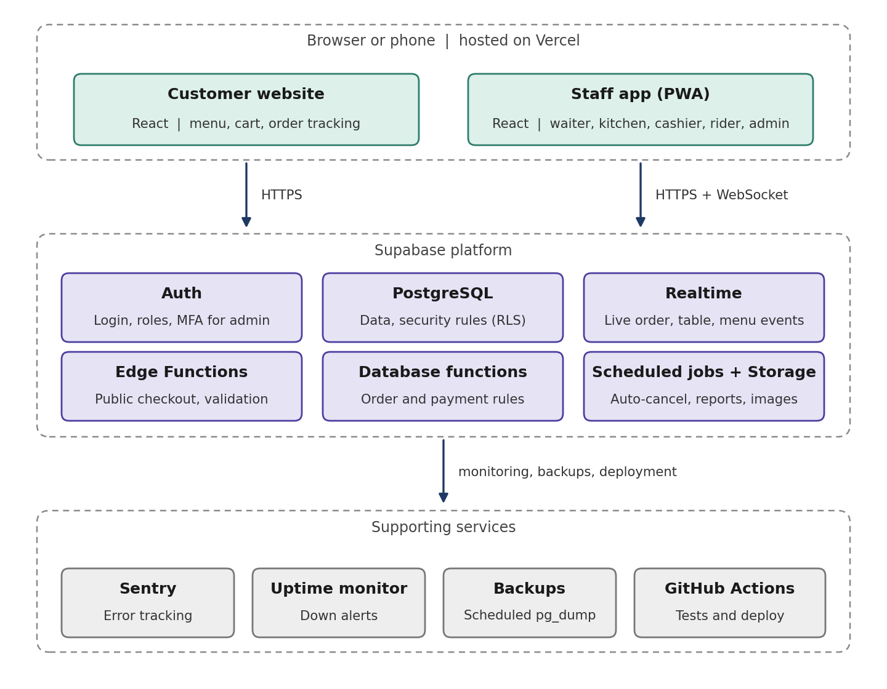

# Restaurant Management System

**Project Plan and Technical Specification**

MVP and full system | Version 1.0 (Draft) | 22 October 2026

> Converted from `docs/Restaurant_Management_System_Project_Plan (1).docx`. The Word file is the original; this Markdown copy is the working reference. IDs (M1-M17, BR-01..BR-25, D1-D14, R1-R10) and phase tags (P0-P5) are unchanged.

## Contents

1. Document control
2. Project summary
3. Scope
4. Users and roles
5. Modules and features
6. Business flows and rules
7. System architecture
8. Technology stack
9. Data model
10. Non-functional requirements
11. Phase plan
12. Testing and go-live
13. Risks and mitigations
14. Assumptions and open decisions
15. Appendix

## 1. Document control

| **Field** | **Value** |
|----|----|
| **Project** | Restaurant Management System (web-based, real-time) |
| **Document** | Project Plan and Technical Specification |
| **Version / status** | 1.0 / Draft for senior review |
| **Date** | 22 October 2026 |
| **Prepared by** | \[Name, to be filled\] |
| **Reviewed by** | \[Senior reviewer, to be filled\] |
| **Intended readers** | Senior reviewer, developers, project owner |
| **How to read phases** | Every feature carries a phase tag: P0 Foundation, P1 MVP, P2 Online ordering, P3 Delivery and reservations, P4 Insights and finance, P5 Future. Developers build only the phase currently approved. |

| **Version** | **Date** | **Description** |
|----|----|----|
| 1.0 | 22 Oct 2026 | First complete draft covering the MVP and the full system. |

## 2. Project summary

### 2.1 Purpose

This document defines what will be built, how it will work, which technologies will be used, and in which phases the system will be delivered. It is the single reference for the senior reviewer and for the developers. The MVP (Phase 1) is specified in full detail. Later phases are described at the level needed to plan, estimate and design for them.

### 2.2 Problem

Many restaurants still take orders on paper or through WhatsApp messages. This causes:

- Wrong or missed orders and slow service.
- Manual billing and calculation mistakes.
- Difficult table management.
- No real-time view of sales, profit or best-selling items.
- No central place to manage Dine-In, Take Away and Online orders together.

### 2.3 Solution

A web-based system with a public customer website and role-based staff apps, built around one real-time order pipeline. Every order, whether taken by a waiter, at the counter or online, is the same kind of record and follows the same path: order, kitchen, serve or handover, payment, report. Staff see only the screen they need, and every change appears on the other screens within seconds.

### 2.4 Goals and success measures

| **Goal** | **Measure (initial target, to be confirmed)** |
|----|----|
| **Fewer order mistakes** | Orders reach the kitchen exactly as entered by the waiter; no handwriting or verbal relay. |
| **Faster service** | An order appears on the kitchen screen within 2 seconds of "Send to Kitchen". |
| **Accurate billing** | Totals are calculated by the system; 100% of test orders match a manual check. |
| **Live coordination** | Status, table and menu changes reach all relevant screens within 2 seconds. |
| **Business visibility** | The owner sees the same-day sales, order count and top items without manual counting. |
| **Easy adoption** | A new staff member can perform their core tasks after about 10 minutes of training. |

## 3. Scope

### 3.1 In scope (by phase)

- **P1 MVP:** Dine-In and counter Take Away orders: menu, tables, waiter app, kitchen screen, cashier payments and receipts, basic daily report, real-time sync.
- **P2:** Public website with online Take Away ordering, order tracking, deals, and online order management.
- **P3:** Delivery with zones and riders, rider app, cash-on-delivery settlement, table reservations.
- **P4:** Profit and finance insights, expenses, shift cash closing, audit log viewer, advanced reports.

### 3.2 Out of scope (not in P1 to P4)

- Inventory and ingredient tracking, supplier management.
- QR-code table ordering and QR menu.
- Online payment gateway (payments are recorded manually in P1 to P4).
- Customer accounts, loyalty program and discounts engine.
- Multi-branch support (the database is prepared, the features are not built).
- Native mobile apps (the staff app is an installable web app, PWA).
- Rider live GPS tracking, WhatsApp or SMS integration, tax filing or accounting integration.
- Direct thermal-printer or kitchen-printer integration (browser printing is used).

## 4. Users and roles

| **Role** | **Who** | **Main tasks** | **Device** |
|----|----|----|----|
| **Admin** | Owner or manager | Manages menu, prices, staff, zones and settings; views all reports; has full access. | Laptop or phone |
| **Cashier** | Counter staff | Counter Take Away orders, accepts online orders, handles bills and payments, assigns riders, settles rider cash, closes shift. | Counter PC or tablet |
| **Waiter** | Floor staff | Takes Dine-In orders at the table, adds items, serves, requests the bill. | Phone or tablet |
| **Chef** | Kitchen staff | Sees the kitchen queue, marks orders Preparing and Ready, marks items Sold Out. | Kitchen tablet or screen |
| **Rider** | Delivery staff | Sees own zone deliveries, marks picked up and delivered, collects cash (P3). | Phone |
| **Customer** | Guest, no login | Views menu, places online order, tracks order, books a table, sends a message (P2, P3). | Own phone or browser |

#### Permission matrix

| **Action** | **Admin** | **Cashier** | **Waiter** | **Chef** | **Rider** |
|----|:--:|:--:|:--:|:--:|:--:|
| Create a Dine-In order | Yes | Yes | Yes | No | No |
| Create a counter Take Away order | Yes | Yes | No | No | No |
| Add items to an open order | Yes | Yes | Own | No | No |
| Remove an item before it is sent to the kitchen | Yes | Yes | Yes | No | No |
| Cancel an item or order after it is sent (reason required) | Yes | Yes | No | No | No |
| Apply a discount (reason required) | Yes | No | No | No | No |
| Mark Preparing and Ready | Yes | Yes | No | Yes | No |
| Mark Served | Yes | Yes | Yes | No | No |
| Mark an item Sold Out | Yes | Yes | No | Yes | No |
| Request the bill | Yes | Yes | Yes | No | No |
| Record payment and print receipt | Yes | Yes | No | No | No |
| Accept or reject online orders (P2) | Yes | Yes | No | No | No |
| Switch Online ON/OFF and Busy mode (P2) | Yes | Yes | No | No | No |
| Assign or re-assign a rider (P3) | Yes | Yes | No | No | No |
| Mark picked up, delivered or failed (P3) | Yes | No | No | No | Own |
| Edit menu, prices and deals | Yes | No | No | No | No |
| View reports, profit and expenses | Yes | No | No | No | No |
| Manage staff, zones and settings | Yes | No | No | No | No |

"Own" means only the user's own tables (Waiter) or own deliveries (Rider). Permissions are enforced in the database, not only in the screens.

## 5. Modules and features

| **ID** | **Module** | **Key features** | **Phase** |
|----|----|----|:--:|
| **M1** | Authentication and staff | Staff login and logout; roles (Admin, Cashier, Waiter, Chef, Rider); Admin creates, edits and deactivates staff; multi-factor login for Admin. | **P1** |
| **M2** | Menu and settings | Categories (sort order, active); menu items with name, price, cost price, photo, description, preparation time, "needs kitchen" flag and availability. Archive instead of delete; Sold Out toggle with live sync. Settings: restaurant details, tax %, service charge %, receipt footer, business-day cut-off. | **P1** |
| **M3** | Tables | Create tables (number, capacity, section); live status (Available, Occupied, Bill Requested); move an order to another table. | **P1** |
| **M4** | Order engine | Create order; unique order number; server-side totals; add-on batches; status flow; remove item; cancel with reason; duplicate-submission protection; price and cost snapshot. | **P1** |
| **M5** | Waiter app | My tables; order screen with categories, search, quantity and notes; Send to Kitchen; Add More Items; Ready alert; Mark Served; Request Bill. | **P1** |
| **M6** | Kitchen screen | Live queue of orders that contain kitchen items; age colour coding; Preparing and Ready buttons; ADD-ON marker; Sold Out toggle; no prices shown. | **P1** |
| **M7** | Cashier and payments | Open bills list; counter Take Away orders; record payment (Cash, Card, split); printable receipt; order completion; table release. | **P1** |
| **M8** | Real-time layer | Live push of order, table and menu changes to the right screens; automatic reconnect and resync; offline banner. | **P1** |
| **M9** | Basic reports | Today's sales, number of orders, average order value, top-selling items, sales by order type. | **P1** |
| **M10** | Audit log (recording) | Automatic record of cancellations, discounts and price changes with user, time and reason. | **P1** |
| **M11** | Public website | Home, Menu, Deals, About, Contact; cart; guest checkout; order confirmation; tracking through a private link. | **P2** |
| **M12** | Deals | Combo deals with a fixed price and validity dates; expired deals hide automatically. | **P2** |
| **M13** | Online order management | Accept or reject; Online ON/OFF; Busy mode; optional auto-accept; automatic cancellation of unaccepted orders; bot protection. | **P2** |
| **M14** | Delivery | Zones with fee and minimum order; rider accounts and on-duty toggle; auto-assignment; rider app; failed delivery handling; cash-on-delivery settlement. | **P3** |
| **M15** | Reservations | Public booking form; Admin or Cashier confirms or rejects; table assignment; double-booking check; Reserved table status. | **P3** |
| **M16** | Insights and finance | Profit and margin from cost price; expenses; shift cash closing; audit log viewer; advanced reports (hourly, category, waiter, cashier, rider, preparation time, cancellations); CSV export. | **P4** |
| **M17** | Future ideas | Inventory, QR table ordering, online payments, loyalty, multi-branch, item-level kitchen status, thermal printer, rider live location. | **P5** |

## 6. Business flows and rules

### 6.1 Dine-In flow (P1)

1. The waiter opens the Tables screen and selects an available table.
2. The waiter chooses items, quantities and notes, then taps **Send to Kitchen**. One order is created with the number ORD-YYYYMMDD-NNN and status Accepted.
3. The kitchen screen shows the order instantly. Items that need no cooking (for example bottled drinks) are not shown to the chef.
4. The chef taps **Preparing** and then **Ready**. The waiter receives an alert (sound, vibration, banner).
5. The waiter serves and taps **Served**. If the customer wants more, the waiter taps **Add More Items**. New items form a new batch, shown to the kitchen as ADD-ON.
6. The waiter taps **Request Bill**. The cashier sees the bill at the top of the open bills list.
7. The cashier records the payment and prints the receipt. The order becomes Completed and the table becomes Available.

### 6.2 Take Away flow

**Counter order (P1):** the cashier creates the order, selects Take Away, enters the customer name and phone, and sends it to the kitchen. After Ready, the cashier hands over the food and records the payment. The order is Completed.

**Online order (P2):** the customer orders on the website. The order is Pending until the cashier accepts it (or auto-accept accepts it). The kitchen steps are the same. Payment is made at pickup.

### 6.3 Delivery flow (P3)

1. The customer selects Delivery, chooses a zone from a list and enters the address. The zone sets the delivery fee and minimum order.
2. The order is Pending. The cashier accepts it (or auto-accept does).
3. The kitchen marks Preparing and Ready.
4. When the order is Ready, the system assigns an on-duty rider of that zone who has the fewest active deliveries. If no rider is available, the cashier assigns one manually.
5. The rider marks **Picked Up** (Out for Delivery), then **Delivered**, or **Failed** with a reason.
6. For cash on delivery, the rider collects the money and hands it to the cashier. The cashier records the settlement and the order is Completed.

### 6.4 Order statuses

| **Status** | **Applies to** | **Meaning** | **Set by** |
|----|----|----|----|
| **Pending** | Online orders | Received, waiting for the cashier to accept. | System |
| **Accepted** | All | Confirmed and sent to the kitchen. Dine-In and counter orders start here. | Cashier, or system (auto-accept, waiter send) |
| **Preparing** | All | The kitchen has started. | Chef |
| **Ready** | All | Ready for serving, pickup or rider. | Chef |
| **Served** | Dine-In | Food delivered to the table. | Waiter |
| **Out for Delivery** | Delivery | The rider has picked up the order. | Rider |
| **Delivered** | Delivery | The rider handed the order to the customer. | Rider |
| **Delivery Failed** | Delivery | Could not be delivered; reason recorded; the cashier decides the next step. | Rider |
| **Completed** | All | Fulfilled (served, handed over or delivered) and fully paid. | System |
| **Cancelled** | All | Cancelled with a reason. | Cashier or Admin; system for auto-cancel |

Payment status is kept separately: **Unpaid** or **Paid**. "Bill Requested" is a flag on the order, not a status.

#### Allowed status changes

| **From** | **Can move to** |
|----|----|
| **Pending** | Accepted, Cancelled |
| **Accepted** | Preparing, Cancelled |
| **Preparing** | Ready, Cancelled (Admin or Cashier, reason required) |
| **Ready** | Served (Dine-In), Out for Delivery (Delivery), Completed (counter Take Away, after payment) |
| **Served** | Completed (after payment) |
| **Out for Delivery** | Delivered, Delivery Failed |
| **Delivered** | Completed (after payment or cash settlement) |
| **Delivery Failed** | Out for Delivery (retry), Cancelled |
| **Completed, Cancelled** | No further changes |

### 6.5 Business rules

| **ID** | **Rule** |
|----|----|
| **BR-01** | Prices are calculated only by the server from the current menu. The screens never send prices. |
| **BR-02** | Each order line stores a snapshot of the item name, price and cost at the time of ordering. Later menu changes do not affect existing orders or reports. |
| **BR-03** | Order numbers use the format ORD-YYYYMMDD-NNN, are unique, and the sequence restarts each business day. |
| **BR-04** | The business day ends at a configurable cut-off time (default 04:00). Orders placed after midnight but before the cut-off belong to the previous business day. |
| **BR-05** | A table has at most one open order (bill) at a time. |
| **BR-06** | Items added after the first send form a new batch. The kitchen sees only the new batch, marked ADD-ON. |
| **BR-07** | Items with "needs kitchen = No" (for example bottled drinks) never appear on the kitchen screen and never delay Ready. |
| **BR-08** | An order becomes Ready when the chef has marked all kitchen batches Ready. An order with no kitchen items is Ready automatically. |
| **BR-09** | A waiter may remove items only before they are sent. After sending, only Cashier or Admin can cancel an item or order, and a reason is mandatory. |
| **BR-10** | Only Admin can apply a discount, and a reason is stored. |
| **BR-11** | Only Cashier or Admin can record payment. Methods: Cash and Card. A payment can be split across methods; the amounts must add up to the total. |
| **BR-12** | An order is Completed only when it is fulfilled and fully paid. Completing a Dine-In order makes the table Available. |
| **BR-13** | Marking an item Sold Out hides it from ordering on every screen at once. Existing orders are not affected. |
| **BR-14** | Menu items and categories are archived, never deleted. |
| **BR-15** | Submitting the same order twice (double tap or network retry) creates one order. Every submission carries a unique request ID. |
| **BR-16** | Tax and service-charge percentages come from Settings and are applied by the server. |
| **BR-17** | For online orders the server re-checks availability and price at checkout and rejects unavailable items with a clear message. |
| **BR-18** | Online ordering can be switched off. Busy mode shows a notice and a longer estimated time to customers. |
| **BR-19** | An online order not accepted within the configured time (default 10 minutes) is cancelled automatically and the customer sees this on the tracking page. |
| **BR-20** | Customers track an order through a private random link, never through the order number. |
| **BR-21** | Delivery fee and minimum order are set per zone. An order below the minimum is rejected. |
| **BR-22** | A rider sees only deliveries in the rider's own zones. Auto-assignment picks the on-duty rider of the zone with the fewest active deliveries; otherwise the cashier assigns. |
| **BR-23** | Cash collected by riders must be settled with the cashier. The system shows the amount due per rider. |
| **BR-24** | Every cancellation, discount and price change is written to the audit log with user, time and reason. |
| **BR-25** | Two reservations cannot overlap for the same table and time. |

## 7. System architecture

### 7.1 Overview

The system has two web front ends and one backend platform. The front ends only display data and collect input. All business rules and security live in the backend, so a staff phone or a customer browser can never change a price, a status or a permission by itself.



*Figure 1: High-level architecture*

| **Layer** | **Components** | **Responsibility** |
|----|----|----|
| **Clients** | Customer website; Staff app (PWA) with Waiter, Kitchen, Cashier, Rider and Admin screens. | Display, input, caching, offline notice. No business decisions. |
| **Backend platform** | Supabase: PostgreSQL, Auth, Realtime, Edge Functions, Storage, scheduled jobs. | Data, security rules, business logic, live updates. |
| **Hosting** | Vercel for both front ends. | Fast delivery over HTTPS, automatic deploys from Git. |
| **Supporting services** | Sentry (errors), uptime monitor, scheduled backups, GitHub Actions. | Visibility, safety and automated delivery. |

### 7.2 Where business logic lives

- Business rules (create order, change status, record payment, assign rider) are PostgreSQL functions that run inside one transaction, so an operation either fully succeeds or fully fails.
- The public checkout goes through one Edge Function that validates the request, takes prices from the database and applies rate limiting. The public never writes to order tables directly.
- Scheduled jobs (auto-cancel, daily summary) run inside the database scheduler.
- The front ends call these functions and never write business data directly.

### 7.3 Real-time design

| **Event** | **Delivered to** |
|----|----|
| **Order created or changed** | Kitchen, the waiter who owns the table, Cashier, Admin, and the customer tracking page for that order. |
| **Table status changed** | Waiters, Cashier, Admin. |
| **Menu or availability changed** | All ordering screens (Waiter, Cashier) and the customer website. |

- Live events are a notification only. After any reconnect, the screen reloads its data so no order can be missed.
- Each screen subscribes only to the channels it needs.
- The server is the single source of truth. A screen never changes a status on its own before the server confirms.

### 7.4 Security model

- Row Level Security is enabled on every table. For example, a waiter sees only own tables, a rider only own zones, and a chef only kitchen items.
- The service-role key is never present in front-end code; it exists only in server-side functions.
- Customers cannot guess other orders: tracking uses a random private token.
- Bot protection (Cloudflare Turnstile) and rate limits on the public checkout.
- HTTPS everywhere; secrets only in environment variables; no secrets in Git.
- Admin accounts use multi-factor login; staff accounts are created only by Admin and are deactivated immediately when someone leaves.
- Audit log entries are written by database triggers, so they cannot be skipped by a screen.

### 7.5 Offline and failure handling

- Each screen shows a clear offline banner and blocks sending while offline, so nothing is half-sent.
- After reconnecting, screens reload automatically.
- Fallback for the restaurant: UPS for the router and counter device, a mobile-data hotspot as backup, and paper order slips as the manual plan if the system is down.

## 8. Technology stack

| **Layer** | **Technology** | **Purpose** |
|----|----|----|
| **Front-end framework** | React with TypeScript (strict), built with Vite | Fast, typed and maintainable user interfaces. |
| **Routing** | React Router with lazy-loaded routes | Fast first load; users download only the screens they use. |
| **Server data** | TanStack Query | Caching, background refresh and instant-feeling navigation. |
| **UI and styling** | Tailwind CSS and shadcn/ui | Consistent, accessible components and a shared design system. |
| **Forms and validation** | React Hook Form and Zod | One validation schema shared by screens and tests. |
| **Client state** | Zustand | Cart and small UI state. |
| **Charts** | Recharts | Dashboard and reports. |
| **Installable app** | PWA (vite-plugin-pwa) | Staff install the app on the phone home screen; asset caching. |
| **Languages** | react-i18next | English strings from day one; Urdu translations when requested (see D9). |
| **Backend platform** | Supabase (PostgreSQL, Auth, Realtime, Edge Functions, Storage) | Database, login, live updates, public checkout function, images. |
| **Database changes** | Supabase CLI with SQL migration files | Every schema change is versioned in Git. |
| **Bot protection (P2)** | Cloudflare Turnstile | Stops fake online orders. |
| **Hosting** | Vercel | Hosting for both front ends. The free Hobby plan is for development and demo only; the live restaurant needs the Pro plan. |
| **Monitoring** | Sentry and an uptime monitor | Error tracking and down alerts. |
| **Testing** | Vitest, Playwright | Unit, database-function and end-to-end tests. |
| **CI/CD** | GitHub and GitHub Actions | Lint, type check, tests and automatic deployment. |
| **Code quality** | ESLint, Prettier, TypeScript strict mode | Consistent code and fewer bugs. |
| **Receipts** | Browser printing with an 80 mm print style | No extra software in P1 to P4. |

### 8.1 Repository structure (monorepo)

```text
restaurant-system/
  apps/
    customer-web/        public website (P2)
    staff-app/           Waiter, Kitchen, Cashier, Rider, Admin (PWA)
  packages/
    shared/              TypeScript types, Zod schemas, constants
    ui/                  shared UI components
  supabase/
    migrations/          SQL schema, policies, functions
    functions/           Edge Functions (place-order, ...)
    seed.sql             demo menu, tables, staff for development
  .github/workflows/     CI/CD pipelines
  docs/                  this document, user guides
```

The customer website and the staff app are separate builds so customers never download staff code. If the team finds this too heavy for the MVP, one app with lazy-loaded routes is an acceptable start.

### 8.2 Environments

| **Environment** | **Backend** | **Used for** | **Deploys from** |
|----|----|----|----|
| **Local** | Supabase local stack (supabase start) | Daily development | Developer machine |
| **Staging** | Separate Supabase project | Testing, demos, user acceptance | Git branch develop |
| **Production** | Separate Supabase project | The live restaurant | Git branch main |

### 8.3 Cost plan

| **Item** | **Development and pilot** | **Live restaurant** |
|----|----|----|
| **Supabase** | Free plan: 2 projects, 500 MB database, 1 GB file storage, about 200 live connections; a project pauses after 7 days of inactivity. | Pro plan, about USD 25 per month plus usage; larger database, no inactivity pause. Recommended before go-live. |
| **Vercel** | Hobby plan: free, for development and demo only (non-commercial use). | Pro plan is required for the live restaurant: about USD 20 per user per month plus usage. |
| **Sentry, uptime monitor, GitHub** | Free plans | Free plans, upgrade only if needed |
| **Domain name** | Not needed (free subdomain) | One yearly fee, optional |

Prices and limits were checked in October 2026 and change over time. They must be confirmed on the official pricing pages before the live decision.

## 9. Data model

### 9.1 Conventions

- Database: PostgreSQL. Primary keys are UUIDs. Times are stored as UTC timestamps and shown in local time.
- Money is stored as integers in the smallest currency unit to avoid rounding errors; screens show the normal currency format.
- Statuses, roles and order types are database enums. Records are archived with an is_active flag, not deleted.
- Every business table has created_at and updated_at, and a branch_id that points to a single default branch (prepared for multi-branch, not used yet).

### 9.2 Tables

| **Table** | **Key fields** | **Phase** |
|----|----|:--:|
| **profiles** | id (linked to login), full_name, phone, role, is_active, on_duty (riders) | **P1** |
| **categories** | name, image, sort_order, is_active | **P1** |
| **menu_items** | category_id, name, description, price, cost_price, image, prep_time_min, needs_kitchen, is_available, is_active | **P1** |
| **restaurant_tables** | number, capacity, section, status | **P1** |
| **orders** | order_number, business_date, type (dine_in, take_away, delivery), source (staff, website), status, table_id, waiter_id, customer_name, customer_phone, zone_id, address, rider_id, subtotal, discount, tax, service_charge, delivery_fee, total, payment_status, bill_requested, tracking_token, request_id, cancel_reason, status timestamps | **P1** |
| **order_items** | order_id, menu_item_id, name_snapshot, price_snapshot, cost_snapshot, quantity, notes, batch_no, needs_kitchen | **P1** |
| **order_batches** | order_id, batch_no, status, sent_at, preparing_at, ready_at, served_at | **P1** |
| **order_status_history** | order_id, from_status, to_status, changed_by, changed_at | **P1** |
| **payments** | order_id, amount, method, received_by, received_at | **P1** |
| **settings** | single row: restaurant name, address, phone, tax_percent, service_charge_percent, day_cutoff_time, receipt_footer, online_ordering_on, busy_mode, auto_accept, auto_cancel_minutes | **P1** |
| **audit_log** | user_id, action, target_table, target_id, reason, old_value, new_value, created_at | **P1** |
| **order_counters** | business_date, last_number (safe order-number generation) | **P1** |
| **deals, deal_items** | title, price, valid_from, valid_to, is_active; deal_id, menu_item_id, quantity | **P2** |
| **messages** | name, phone or email, text (contact form) | **P2** |
| **zones, rider_zones** | name, delivery_fee, min_order, is_active; rider_id, zone_id | **P3** |
| **rider_settlements** | rider_id, amount, settled_by, settled_at | **P3** |
| **reservations** | name, phone, reserved_at, guests, status, table_id | **P3** |
| **expenses** | expense_date, category, amount, note, added_by | **P4** |
| **shifts** | cashier_id, opened_at, closed_at, opening_cash, closing_cash, expected_cash, difference | **P4** |

### 9.3 Main relationships

- One order has many order_items, many order_batches, many payments and many status history rows.
- One restaurant table has at most one open order at a time; one order belongs to at most one table.
- A menu item belongs to one category and appears in many order_items (as a snapshot, so history never changes).
- A rider can work in many zones; a zone can have many riders; an order belongs to at most one zone and one rider.

## 10. Non-functional requirements

| **Area** | **Requirement** |
|----|----|
| **Performance** | Live updates within 2 seconds. Public website first load under 200 KB of JavaScript (compressed) and a mobile Lighthouse performance score of 90 or more (targets). Skeleton loaders instead of blank screens. |
| **Security** | Section 7.4 applies in full. Row Level Security on every table, with automated tests for each role. |
| **Reliability** | Duplicate-submission protection, automatic resync after reconnect, clear offline banner, scheduled backups with a tested restore. |
| **Usability** | Core tasks in 1 to 3 taps; touch targets at least 44 px; large readable text; English labels with Urdu option (D9); saved name, phone and address on the customer device. |
| **Compatibility** | Latest two versions of Chrome, Edge and Safari; Android and iOS phones; desktop browsers. |
| **Capacity** | Designed for one restaurant: about 15 to 20 staff screens and a few dozen customers tracking orders at the same time. Estimated 100 orders per day uses roughly 100 MB per year (to be validated in the MVP). |
| **Maintainability** | TypeScript strict mode, migrations in Git, tests for database functions and critical flows, a README and this document kept up to date. |
| **Backup** | At least a weekly database dump on the free plan; a daily backup is recommended for live use. Restore is tested before go-live. |

## 11. Phase plan

| **Phase** | **Name** | **Duration (indicative)** | **Main outcome** |
|:--:|----|----|----|
| **P0** | Foundation | 1 week | Secure base: repository, environments, login, roles, CI/CD. |
| **P1** | MVP: Dine-In core | 4 to 5 weeks | Complete in-restaurant flow from order to payment, live on all screens. |
| **P2** | Online ordering | 3 weeks | Public website, online Take Away, tracking, online order management. |
| **P3** | Delivery and reservations | 3 weeks | Zones, riders, rider app, cash settlement, table reservations. |
| **P4** | Insights and finance | 3 weeks | Profit, expenses, shift closing, audit viewer, advanced reports. |
| **P5** | Future | Planned separately | Inventory, QR ordering, online payments, loyalty, multi-branch. |

Durations are indicative for a team of 2 to 3 developers working full time. They must be confirmed once the team and start date are fixed (D11).

### Phase 0: Foundation

**Scope:** monorepo, Supabase staging and production projects, migration workflow, login, roles table and baseline security rules, CI pipeline, deployed skeleton apps, design tokens and base components.

**Done when:** a user can log in on staging and lands on the screen for the role; CI runs lint, type check and tests on every push; staging and production both deploy from Git.

### Phase 1: MVP (Dine-In core)

**Goal:** the complete in-restaurant flow works reliably: order, kitchen, serve, bill, payment, receipt.

**Scope:** modules M1 to M10.

**Deliverables:**

- Admin screens for menu, categories, tables, staff, settings and the daily report.
- Waiter app, kitchen screen and cashier screen with printable receipts.
- Real-time sync, role permissions, audit recording, duplicate protection.
- Automated tests, a one-page user guide per role, and deployment to staging and production.

**Done criteria (all must pass):**

1. A waiter creates an order of 5 items for a table on a phone in under one minute.
2. The order appears on the kitchen screen within 2 seconds of Send to Kitchen, and the Ready alert reaches the waiter within 2 seconds.
3. Add-on items appear in the kitchen marked ADD-ON; bottled-drink items never appear in the kitchen.
4. A Sold Out change shows on all screens within 2 seconds.
5. The cashier records Cash, Card and split payments; the receipt prints; the table becomes Available.
6. Every permission in section 4 is verified by automated tests.
7. A double tap on Send creates only one order.
8. The Admin sees today's sales, order count and top items, matching the test data exactly.
9. A simulated day of at least 50 test orders finishes with no wrong totals and no lost orders.

10. The apps work on current Android Chrome, iOS Safari and desktop Chrome or Edge.

### Phase 2: Online ordering

**Scope:** M11, M12, M13.

**Done when:** a customer completes an online Take Away order on a phone; the cashier hears and sees it; tracking updates within 2 seconds; unavailable items are rejected at checkout; Online OFF blocks orders; an unaccepted order is cancelled after the configured time; bot protection is active; the performance targets in section 10 are met.

### Phase 3: Delivery and reservations

**Scope:** M14, M15.

**Done when:** the zone sets the correct fee and minimum order; a rider is auto-assigned in the right zone; a rider sees only own-zone orders; failed delivery and cash settlement work and show correct amounts; a reservation cannot be double-booked.

### Phase 4: Insights and finance

**Scope:** M16.

**Done when:** profit and margin match a manual calculation on test data; expenses and shift closing show the correct difference; the audit log can be filtered by user, action and date; reports export to CSV.

### Phase 5: Future

Inventory, QR table ordering, online payments, loyalty, multi-branch, item-level kitchen status, thermal printer integration, rider live location. Each item is planned as a separate project after P4.

## 12. Testing and go-live

| **Test level** | **What it covers** |
|----|----|
| **Unit tests** | Calculations, validation rules and helper functions (Vitest). |
| **Database tests** | Each database function and every Row Level Security policy for every role. |
| **End-to-end tests** | Full flows in a real browser (Playwright): Dine-In, counter Take Away, online order, delivery. |
| **User acceptance** | Owner and staff run a test day on staging with real menu data. |
| **Smoke load test** | About 50 simultaneous screens and 200 orders in an hour on staging. |

#### Go-live steps (for P1)

1. Complete the done criteria on staging and obtain owner sign-off.
2. Load the real menu, tables and staff accounts into production; upgrade Supabase and Vercel to the Pro plan; confirm backups and monitoring alerts.
3. Run a parallel period of 3 to 7 days: staff use the system and also the old paper slips; totals are compared every night.
4. Train each role (about 10 minutes each) with the one-page guide.
5. Switch to the system only. A developer is available during the first week and a daily feedback list is kept.

**Rollback plan:** continue with paper slips, redeploy the previous version from Git, and restore the latest backup if data is damaged.

## 13. Risks and mitigations

| **ID** | **Risk** | **Impact** | **Mitigation** |
|----|----|----|----|
| **R1** | Internet or power failure | Orders cannot be sent | UPS, mobile hotspot, offline banner, paper fallback, automatic resync. |
| **R2** | Free-plan limits (pause, storage, live connections) | Downtime | Pro plan before go-live; monitor usage; scheduled backups. |
| **R3** | Team new to SQL and Row Level Security | Delay or security gaps | Early design spike; automated policy tests; senior review of every migration. |
| **R4** | Low staff adoption | System not used properly | Simple screens, 10-minute training, parallel run, daily feedback. |
| **R5** | Scope creep | MVP delayed | Fixed MVP scope; new requests go to a later phase. |
| **R6** | Wrong totals or data errors | Financial loss | Server-side calculation, database constraints, tests, nightly reconciliation in the parallel run. |
| **R7** | Fake orders or data exposure | Cost, privacy | Row Level Security, Edge Function validation, rate limits, Turnstile, private tracking links. |
| **R8** | Knowledge held by one person | Hard to maintain | Migrations and docs in Git, README, code review for every change. |
| **R9** | Platform price or limit changes | Unexpected cost | Standard PostgreSQL allows moving elsewhere; recheck pricing before decisions. |
| **R10** | Phone limits (alerts when the app is in the background) | Missed alerts | Keep the screen awake with in-app sound during shifts; native push can be considered later. |

## 14. Assumptions and open decisions

### 14.1 Assumptions

- One restaurant branch.
- Wi-Fi covers the dining area, counter and kitchen.
- Staff use phones or tablets with a current browser.
- Payments are recorded manually in P1 to P4 (Cash and Card); there is no payment gateway.
- Customers do not need accounts.
- The team has 2 to 3 developers (to be confirmed).

### 14.2 Open decisions

| **ID** | **Decision** | **Proposed default** | **Needed by** |
|----|----|----|----|
| **D1** | Approve Supabase (PostgreSQL) as the backend platform | Approve (see section 8) | Before P0 |
| **D2** | Currency, tax % and service charge | Owner provides | Before P1 |
| **D3** | Receipt layout and printer model | Browser print on 80 mm paper | End of P1 |
| **D4** | Discount policy | Admin only (BR-10) | P1 |
| **D5** | Menu list, prices, cost prices and photos | Owner provides | P1 |
| **D6** | Table list (numbers, capacity, sections) | Owner provides | P1 |
| **D7** | Online auto-accept and auto-cancel time | Auto-accept off; auto-cancel after 10 minutes | P2 |
| **D8** | Delivery zones, fees, minimum orders, number of riders | Owner provides | P3 |
| **D9** | Interface languages | English first; Urdu labels added if the owner requests | P1 |
| **D10** | Business-day cut-off time | 04:00 | P1 |
| **D11** | Team size, start date and target go-live date | To be confirmed | Before P0 |
| **D12** | Domain name for the website | To be confirmed | P2 |
| **D13** | Restaurant internet reliability and backup connection | Survey before go-live | Before go-live |
| **D14** | Front-end hosting for the live restaurant | Vercel Pro (Hobby is non-commercial); Cloudflare Pages is a free alternative | Before go-live |

## 15. Appendix

### A. Screens by role

| **Role** | **Screens** |
|----|----|
| **Waiter** | Tables, Order (menu and cart), My open orders, Bill request. |
| **Chef** | Kitchen queue, Sold Out list. |
| **Cashier** | Open bills, New counter order, Payment and receipt, Online orders (P2), Rider settlement (P3), Shift closing (P4). |
| **Rider (P3)** | My deliveries, Delivery detail, On duty toggle. |
| **Admin** | Dashboard, Menu and categories, Deals (P2), Tables, Staff, Zones (P3), Reservations (P3), Settings, Reports, Expenses (P4), Audit log (P4). |
| **Customer (P2)** | Home, Menu, Deals, About, Contact, Cart, Checkout, Order tracking, Reservation (P3). |

### B. Key backend operations

| **Operation** | **Called by** | **What it does** |
|----|----|----|
| **place_order (Edge Function)** | Customer website (P2) | Validates the cart, takes prices from the database, applies rate limit, creates a Pending order and returns the private tracking link. |
| **create_order** | Waiter, Cashier | Creates a Dine-In or counter order with items, totals and order number in one transaction; sends it to the kitchen. |
| **add_items_to_order** | Waiter, Cashier | Adds a new batch to an open order. |
| **remove_or_cancel_item** | Waiter (before send), Cashier, Admin | Removes or cancels an item; requires a reason after send; writes the audit log. |
| **set_order_status** | Chef, Waiter, Cashier, Rider | Checks that the status change is allowed for the role and writes the history. |
| **request_bill** | Waiter | Flags the order as Bill Requested and notifies the cashier. |
| **record_payment** | Cashier, Admin | Stores the payment, updates payment status, completes the order and frees the table. |
| **apply_discount** | Admin | Applies a discount with a reason; writes the audit log. |
| **set_item_availability** | Chef, Cashier, Admin | Marks an item Sold Out or available and notifies all screens. |
| **assign_rider (P3)** | System, Cashier | Assigns a rider by zone rules or manually. |
| **settle_rider_cash (P3)** | Cashier | Records cash handed over by a rider. |
| **auto_cancel_unaccepted (job, P2)** | Scheduler | Cancels online orders not accepted within the time limit. |
| **daily_summary (job)** | Scheduler | Prepares the daily sales summary for fast reports. |

### C. Engineering standards

- **Git:** main is production, develop is staging, work happens in feature branches. Every change goes through a pull request with at least one review.
- **Database:** every change is a migration file; no manual changes in the dashboard of production.
- **Naming:** snake_case in the database, camelCase in TypeScript, clear English names.
- **Quality gate:** lint, type check and tests must pass before merge.
- **Secrets:** only in environment variables; the service-role key never reaches the browser.
- **Definition of done for a task:** works as specified, has tests where the rules affect money or permissions, reviewed, merged, deployed to staging, documented if behaviour changed.

### D. Glossary

| **Term** | **Meaning** |
|----|----|
| **MVP** | Minimum Viable Product: the smallest version that is useful in real daily work (Phase 1). |
| **PWA** | Progressive Web App: a website that can be installed on the phone home screen and opens full screen. |
| **Batch** | A group of items sent to the kitchen together. Items added later form a new batch (ADD-ON). |
| **Business day** | The trading day, which can end after midnight at a configurable cut-off time. |
| **RLS** | Row Level Security: database rules that decide which rows each user may read or change. |
| **Edge Function** | A small server-side function used for the public checkout. |
| **Snapshot** | A copy of the name, price and cost stored on the order line at the time of ordering. |
| **COD** | Cash on delivery: the rider collects payment from the customer. |
| **Zone** | A delivery area with its own fee, minimum order and assigned riders. |
| **UAT** | User acceptance testing: the owner and staff test the system before go-live. |
